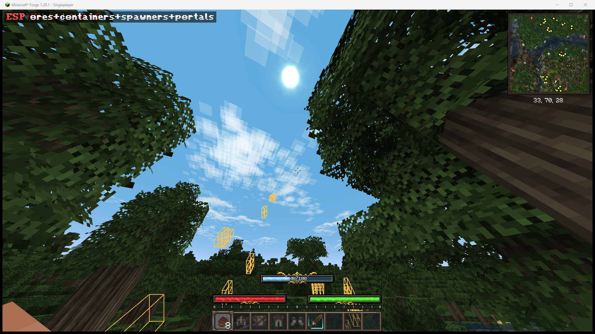
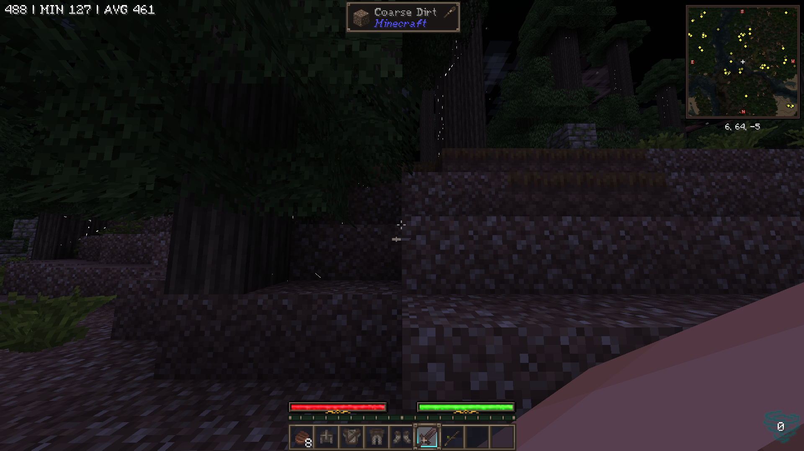
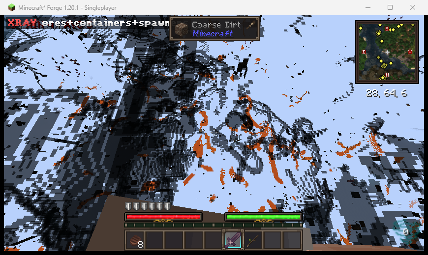

# XrayPlus

Mod **Xray client-side** cho Minecraft **1.20.1 / Forge 47.x**, được dựng riêng cho modpack
**Soulrend – Dark Fantasy RPG Soulslike** (pack dùng Embeddium + Oculus, nên XrayPlus hook vào cả
đường render của vanilla lẫn của Embeddium).

> ⚠️ Chỉ dùng cho **single-player** hoặc **server của chính bạn**. Dùng Xray trên server công khai
> gần như chắc chắn vi phạm luật server và có thể bị ban. Mod không gửi packet nào lên server, không
> sửa dữ liệu thế giới — nó chỉ thay đổi những gì *máy bạn vẽ ra*.

---

## Hai chế độ

| Mode | Hành vi | Dùng khi nào |
|---|---|---|
| **ESP** (mặc định) | Địa hình render **bình thường**, mỗi block trong danh sách được vẽ **khung màu xuyên tường** | Chơi/đi lại bình thường, vẫn thấy đường, vẫn định hướng — quặng hiện thành khung |
| **XRAY** | Ẩn mọi block không có trong danh sách (địa hình trong suốt) | Nhìn bao quát cả mạch quặng; có thể bật `outlineTerrain` để vẽ viền mờ các block quanh người cho dễ đi |

Đổi bằng `/xray mode esp|xray`, nút **Mode** trong `F9`, hoặc sửa `"mode"` trong config.

Màu khung: quặng vàng hổ phách, rương xanh lá, spawner đỏ, portal tím (đổi được bằng `"color": "#RRGGBB"` cho từng group).

## Tính năng

| Tính năng | Mô tả |
|---|---|
| ESP xuyên tường | Khung 3D quanh quặng/rương/spawner, địa hình vẫn bình thường nên không mất định hướng |
| Xray cổ điển | Ẩn block không nằm trong danh sách — vẫn giữ làm tuỳ chọn |
| Fullbright | Ghi đè lightmap thành trắng → thấy rõ trong hang tối, ban đêm |
| 4 nhóm mặc định | `ores`, `containers`, `spawners`, `portals` — bật/tắt từng nhóm |
| Tự dò quặng | Block nào có id chứa `_ore` / `raw_..._block` sẽ tự động được thêm (bắt được quặng của mod) |
| Tag của Forge | Đọc `forge:ores`, `c:ores` → quặng của mod nào có tag là hiện |
| `/xray` command | thêm/xoá block, bật/tắt nhóm, đổi mode, chỉnh bán kính, reload config ngay trong game |
| GUI cấu hình | `F9` hoặc Mods → XrayPlus → Config |
| HUD nhỏ | Góc trên trái hiện `ESP ores+containers` khi đang bật |
| Config JSON | `config/xrayplus.json`, sửa tay được, có `/xray reload` |

## Yêu cầu

- Minecraft **1.20.1**
- Forge **47.x** (đã test với 47.4.26 — bản mà Soulrend v8.5.2 dùng)
- Client. Không cần cài trên server; mod khai báo `clientSideOnly` + `displayTest = IGNORE_ALL_VERSION`
  nên vào server vanilla/Forge bình thường không bị kick vì thiếu mod.

## Cài đặt

1. Tải `xrayplus-1.0.0.jar` (build từ source hoặc Release).
2. Bỏ vào `.../instances/Soulrend - Dark Fantasy RPG Soulslike/minecraft/mods/`.
3. Khởi động lại game.

Trong game:

| Phím | Việc |
|---|---|
| `` ` `` (phím cạnh số 1) | Bật/tắt Xray |
| `F9` | Mở bảng cấu hình |

Phím đổi được ở **Options → Controls → Key Binds → XrayPlus** (mặc định không đè phím của mod nào
trong pack — `X` đã bị 4 mod khác giành).

## Lệnh

```
/xray                     bật/tắt
/xray on | off
/xray status              trạng thái + số block đang hiện
/xray list                liệt kê block đang hiện
/xray mode esp|xray       đổi chế độ (không tham số = đảo mode)
/xray radius 48           bán kính quét ESP (8–96 block)
/xray scan                báo cáo quanh đây có quặng gì (số lượng + toạ độ gần nhất)
/xray scan 96             quét với bán kính khác (8–128)
/xray find <block_id>     đặt focus 1 loại quặng + báo vị trí gần nhất
/xray focus <block_id>    đặt focus (khung cyan), /xray focus clear để bỏ
/xray onlyfocus on|off    chỉ vẽ đúng block đang focus, ẩn các loại khác
/xray audit               liệt kê block giống quặng nhưng chưa được nhận diện
/xray through on|off      khung xuyên tường hay không
/xray outline on|off      (mode xray) vẽ viền mờ block quanh người
/xray groups              trạng thái các nhóm
/xray group <id> on|off   bật/tắt 1 nhóm (ores, containers, spawners, portals)
/xray add <block_id>      luôn hiện block này
/xray remove <block_id>   luôn ẩn block này
/xray fullbright on|off
/xray hud on|off
/xray heuristic on|off
/xray reload              đọc lại config/xrayplus.json
/xray reset               về mặc định
```

## Cấu hình

`config/xrayplus.json` được tạo ở lần chạy đầu:

```json
{
  "enabled": false,
  "mode": "esp",
  "espRadius": 48,
  "espThroughWalls": true,
  "espMaxBlocks": 400,
  "scanRadius": 64,
  "focusBlock": null,
  "focusOnly": false,
  "outlineTerrain": true,
  "outlineRadius": 10,
  "fullbright": true,
  "hud": true,
  "nameHeuristic": true,
  "groups": [
    {
      "id": "ores",
      "enabled": true,
      "tags": ["forge:ores", "c:ores"],
      "blocks": ["minecraft:ancient_debris", "minecraft:amethyst_cluster"],
      "color": "#FFC24A"
    },
    {
      "id": "containers",
      "enabled": true,
      "tags": [],
      "blocks": ["minecraft:chest", "minecraft:trapped_chest", "minecraft:barrel"]
    }
  ],
  "extraBlocks": [],
  "blacklist": []
}
```

Muốn thêm quặng của mod khác: `/xray add <modid:block>` — không cần sửa file.

## Cách hoạt động

Ba mixin, tất cả đều client-side:

1. `ModelBlockRendererMixin` — chặn `tesselateWithAO` / `tesselateWithoutAO` (bản overload
   `ModelData + RenderType` do Forge thêm). Đây là điểm mà cả vanilla **và** `ForgeBlockRenderer`
   của Embeddium gọi vào, nên một hook phủ được cả hai đường.
2. `EmbeddiumBlockRendererMixin` — Embeddium (Sodium) tự dựng mesh trong
   `pipeline/BlockRenderer#renderModel` và **không** đi qua `tesselateBlock`; hook thứ hai chặn
   đúng chỗ đó. Hook đọc `BlockRenderContext#state()` bằng reflection (không phụ thuộc compile-time
   vào Embeddium) và `@Pseudo` để pack không có Embeddium vẫn load bình thường.
3. `LightTextureMixin` — với Xray bật, ghi 16×16 pixel của lightmap thành trắng và upload. Cách này
   không phụ thuộc renderer nào (vanilla, Embeddium, Oculus đều sample cùng một texture lightmap).

**Mode ESP** không dùng mixin nào: mỗi 10 tick nó quét các chunk section quanh người chơi
(`LevelChunkSection#maybeHas` để bỏ qua section rỗng), lấy block thuộc whitelist, rồi vẽ khung bằng
`RenderLevelStageEvent.Stage.AFTER_LEVEL` → `LevelRenderer.renderLineBox` vào một batch
`POSITION_COLOR_NORMAL` với shader `rendertype_lines`. Khi `espThroughWalls = true` thì tắt depth test
nên khung nhìn xuyên đá; tắt option đó thì khung bị che như block bình thường.

Bật/tắt sẽ gọi `LevelRenderer#allChanged()` để dựng lại chunk mesh ngay (Embeddium cũng hook hàm này),
nên không cần F3+A bằng tay.

## Giới hạn đã biết

- **ESP** chỉ quét trong bán kính `espRadius` (mặc định 48 block) và tối đa `espMaxBlocks` khung, nên
  quặng ở rất xa không hiện — tăng bằng `/xray radius 96`.
- **XRAY**: cả vanilla lẫn Embeddium đều bỏ qua những *section* 16×16×16 bị đá bịt kín hoàn toàn. Với
  pack có Embeddium, XrayPlus tự tắt occlusion culling của Embeddium **khi ở mode XRAY**
  (`OcclusionCuller#findVisible` → `useOcclusionCulling = false`), nên quặng trong section kín vẫn
  hiện. Nếu chạy **không** có Embeddium/Sodium thì chỉ có hook vanilla và quặng trong section kín
  hoàn toàn có thể không hiện.
- **Shader pack (Oculus)**: fullbright dùng lightmap nên vẫn ăn với phần lớn shader, nhưng một số
  shader tự tính ánh sáng từ shadow map — khi đó bật/tắt shader sẽ thấy khác nhau. Khung ESP vẽ ở
  stage `AFTER_LEVEL` nên vẫn hiện trên shader.
- Không ẩn chất lỏng (nước/dung nham) vì chúng đi qua `LiquidBlockRenderer`/`FluidRenderer` riêng.
- Không có "cave finder"/"chỉ hiện block trong suốt" — cố tình giữ mod nhỏ và ít xung đột.

## Quét & tìm quặng

Nhìn tổng quát không cho biết nên đào gì, nên có thêm 2 lệnh:

```
/xray scan
  Trong 64 block: 7 loại, 12.415 block
   • minecraft:coal_ore ×5531 — gần nhất -46 62 24 (12m)
   • minecraft:copper_ore ×3914 — gần nhất -54 73 24 (14m)
   • minecraft:iron_ore ×2335 — gần nhất -33 67 26 (9m)
   • minecraft:lapis_ore ×451 — gần nhất -38 64 31 (11m)
   • minecraft:gold_ore ×99 — gần nhất -43 24 41 (51m)
   • minecraft:redstone_ore ×83 — gần nhất -46 11 36 (62m)
   • minecraft:diamond_ore ×2 — gần nhất -97 10 22 (84m)

/xray find minecraft:diamond_ore
  Focus minecraft:diamond_ore: 2 block trong 64 block, gần nhất -97 10 22 (84m)
```

`/xray find` set luôn **focus**: block đó được vẽ khung **cyan** nổi bật; `/xray onlyfocus on` thì chỉ vẽ đúng nó.
HUD thêm dòng `◇ minecraft:diamond_ore 84m`. Bán kính quét là hình trụ (X/Z ± R, Y ± R), mặc định 64.

## Độ phủ quặng (kiểm tra thật, không đoán)

`/xray audit` duyệt toàn bộ block registry của pack và so với whitelist. Kết quả chạy thật trong Soulrend v8.5.2:

```
whitelist=141  oreLike=131  missing=0
```

Nghĩa là **131/131 block giống quặng đã được nhận diện**, gồm quặng của: vanilla (kể cả deepslate),
`cinderscapes`, `natures_spirit`, `cataclysm`, `soulsweapons`, `outer_end`, `irons_spellbooks`,
`dungeons_and_combat`, `iceandfire`, `samurai_dynasty`, `deeperdarker`, `alexscaves`, `quark`, `create`.

Heuristic cố tình **loại** các block chỉ giống quặng về tên như `*_crystal_lamp`, `crystal_chest`,
`crystal_barrel`, `*_display`, `*_skeleton`, `crystal_seashelf` — chúng là nội thất, không phải quặng,
và từng làm ESP vẽ kín màn hình.

## Ảnh chụp thật (Soulrend v8.5.2, Forge 1.20.1, 509 mod)

**Mode ESP** — địa hình bình thường, khung vàng hổ phách quanh quặng vẽ xuyên qua tán cây/đá:



**Mode XRAY** — ẩn địa hình, chỉ còn block trong danh sách (dùng khi muốn nhìn bao quát mạch quặng):

| Xray tắt | Xray bật (`` ` ``) |
|---|---|
|  |  |

## Kiểm chứng thực tế

Đã chạy trong chính instance `Soulrend - Dark Fantasy RPG Soulslike` (509 mod, Embeddium 0.3.31 + Oculus):

- `latest.log`: `- xrayplus 1.0.0` trong danh sách mod, `[XrayPlus] Client bootstrap complete (34 blocks visible)`.
- `debug.log`: Mixin áp thành công — `Mixing ModelBlockRendererMixin ... into net.minecraft.client.renderer.block.ModelBlockRenderer`,
  `Mixing LightTextureMixin ... into net.minecraft.client.renderer.LightTexture`.
- Embeddium xác nhận hook của mod trên class của nó:
  `Mod(s) [xrayplus, copycats] are modifying Embeddium class ...pipeline.BlockRenderer` và
  `[flerovium, xrayplus] are modifying ...occlusion.OcclusionCuller`.
- Sau khi vào thế giới, tag `forge:ores` được bind lại: **95 block** hiển thị (34 lúc mới load mod, vì tag chưa có).
- Build kiểm thử có một hook tạm (đã xoá trước khi release) ghi lại trạng thái runtime:
  `active=true visible=95 fullbright=true`.

## Build từ source

Cần JDK 17 và mạng (lần build đầu tải Forge MDK + mappings, ~5–10 phút).

```bash
./gradlew build
# jar thành phẩm: build/reobfJar/output.jar
```

`reobfJar` là bản đã remap sang SRG — **đây là jar dùng để chơi**, không dùng `build/libs/*-dev.jar`.

## Cấu trúc

```
src/main/java/com/bdtg/xrayplus/
├── XrayPlus.java              # @Mod entry
├── client/                    # keybind, command, HUD, config screen, world refresh
├── config/XrayConfig.java     # JSON config
├── core/XrayState.java        # tập block đang hiện + quyết định ẩn/hiện
├── core/SodiumCompat.java     # đọc state từ Embeddium context (reflection)
└── mixin/                     # 3 mixin kể trên
```

## License

MIT — xem [LICENSE](LICENSE).
